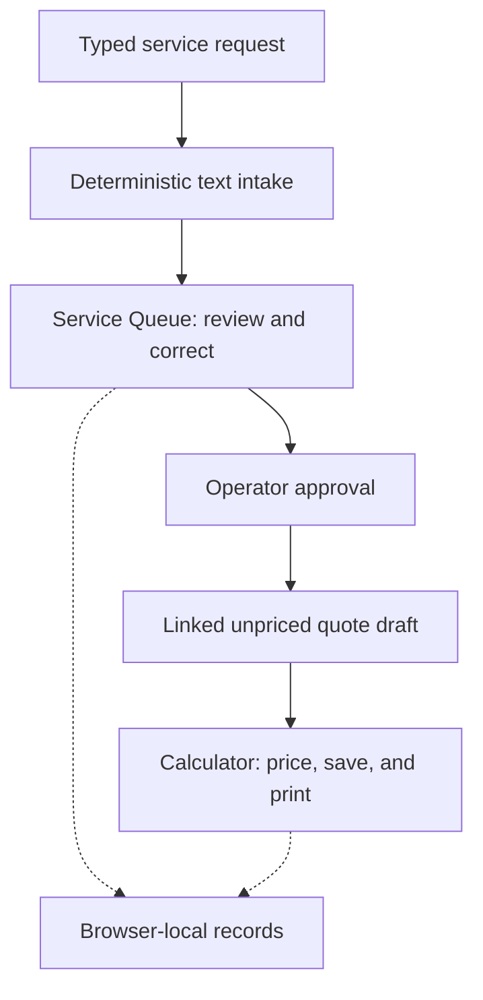
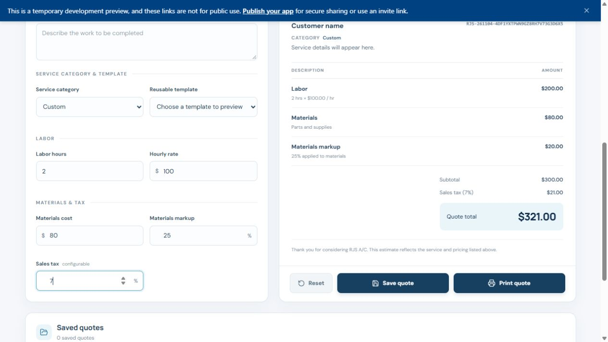

# RJS A/C Quote Calculator

An HVAC service intake and quoting prototype. It turns an incomplete service request into a reviewed, itemized estimate while giving the operator control over approval and pricing.

## Walkthrough

1. Enter a fictional request from Avery Example for an A/C that runs but does not cool. The demo uses deterministic text intake to identify missing required information.
2. Open the request in the Service Queue, complete the contact and service details, and explicitly approve it. Incomplete requests are blocked from approval and quote generation.
3. Generate and open the linked unpriced quote draft. Add two hours of labor at $100 per hour and $80 in materials with a 25% materials markup.
4. Review the $300 subtotal and $21 sales tax at the example rate of 7%, for a $321 estimate. Save the quote and use print preview to review the itemized output.

## Architecture

The TypeScript prototype uses a React/Vite frontend and an Express backend. The calculator and queue currently store their records in the browser, scoped to the browser profile and site origin.

The approval step gives the operator a chance to correct the intake before a quote exists. Keeping pricing in the calculator gives the operator a separate decision about what to charge. The queue links back to the quote so both records can be reopened during the same browser session or after a reload.

## Validation and next steps

A calculator smoke check captured the $321 example above.

 The project readiness report recorded passing frontend, mocked API, and offline database-harness tests, along with TypeScript checks and production builds. Peer acceptance testing was pending in the available test notes.

Planned work includes PostgreSQL persistence, authenticated access to shared records, and AWS deployment.
